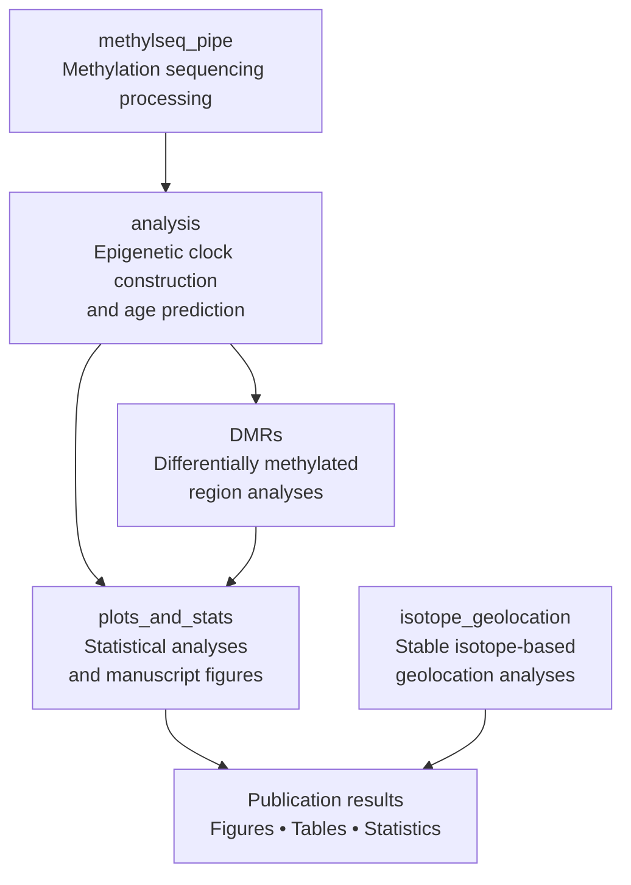

# Butterfly_DNAm_age

This repository contains code related to the publication "An epigenetic aging clock in butterflies".

10.1098/rspb.xxxx.xxxx (to be updated)

A typical workflow is:

1. Process methylation sequencing data using scripts in **methylseq_pipe/**.
2. Construct DNA methylation clocks using scripts in **analysis/**.
3. Perform DMR analyses using scripts in **DMRs/**.
4. Generate figures and statistical summaries using **plots_and_stats/**.
5. Run isotope-based geolocation analyses from **isotope_geolocation/** if required.

## Repository workflow

**License**

This project is distributed under the terms of the license provided in the LICENSE file.
